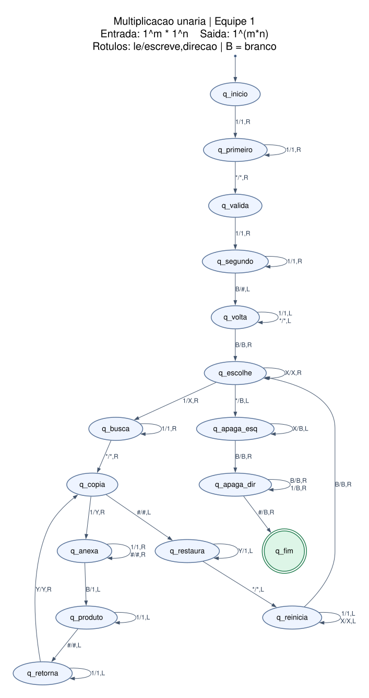

# Máquina de Turing: multiplicação unária

Implementação da issue #1, separada do motor em `src/tm/`.
As regras estão em [`../machines/multiplicacao.txt`](../machines/multiplicacao.txt).
O motor existente carrega esse arquivo; nenhum cálculo fica escrito em Python.

## Entrada e saída

A entrada é `1^n*1^m`, com `n,m >= 1`, exatamente um `*` e sem espaços.
Os dois fatores precisam conter pelo menos um `1`: `*11`, `11*` e `*`
são entradas inválidas e são rejeitadas sem regra aplicável.
Use o asterisco ASCII `*`, não o símbolo tipográfico `∗`.

Na parada, a fita contém apenas `1^(n*m)`, cercada de brancos `B`.
O cabeçote termina na primeira célula do produto.
O produto fica à direita da entrada original; não precisa começar no índice 0.

O único estado final é `q_fim`. O motor o informa como `Status.ACCEPTED`,
que aqui significa que o transdutor concluiu o cálculo.
Não há transição para entradas como `111`, `1**1` ou `**`: elas são rejeitadas
antes de começar o cálculo. Letras, espaços e marcadores internos causam
`InputError`, pois não pertencem ao alfabeto de entrada. A cadeia vazia também
causa `InputError` no motor existente.

## Estratégia

Para cada `1` do primeiro operando, copia-se o segundo operando para o produto.
Isso equivale a somar o segundo número tantas vezes quanto o primeiro indicar.

| Símbolo | Significado |
| --- | --- |
| `1` | Uma unidade |
| `*` | Separador dos operandos |
| `X` | Unidade do primeiro operando já selecionada |
| `Y` | Unidade do segundo operando já copiada na rodada atual |
| `#` | Separador entre o segundo operando e o produto |
| `B` | Branco; apagar uma célula significa escrever `B` |

1. Valida o formato e escreve `#` após o segundo operando.
2. Troca um `1` do primeiro operando por `X`.
3. Percorre o segundo operando: troca cada `1` por `Y` e acrescenta um `1` após `#`.
4. Restaura os `Y` para `1` e volta ao início para selecionar outra unidade.
5. Quando não restam unidades no primeiro operando, apaga os operandos e os
   separadores e para em `q_fim`.

Exemplo de marcos da execução (vários passos entre cada linha):

```text
111*11        entrada: 3 × 2
111*11#       formato validado; área do produto preparada
X11*11#11     primeira cópia concluída e Y restaurados
XX1*11#1111   segunda cópia concluída e Y restaurados
XXX*11#111111 terceira cópia concluída e Y restaurados
111111        operandos e separadores apagados
```

Após `k` rodadas completas, existem `k` marcadores `X`, o segundo operando
foi restaurado e o produto contém `k*m` unidades. Cada rodada marca mais uma
unidade do primeiro operando; portanto, após `n` rodadas, o produto tem `n*m`
unidades. As varreduras percorrem trechos finitos e a limpeza encerra a execução.
Fatores vazios são rejeitados durante a validação, antes de criar `#`.

## Diagrama de estados



Cada rótulo segue `lê/escreve,direção`. `R` move para a direita, `L` para a
esquerda e `S` manteria a posição (esta máquina não precisa de `S`).
Linhas no mesmo arco representam transições distintas. A seta sem origem
indica o estado inicial; o círculo duplo indica a parada.
O diagrama mostra todas as 33 transições do `.txt`.
Transições ausentes causam rejeição em estados não finais.

| Estado | Função |
| --- | --- |
| `q_inicio` | Exigir o primeiro `1` do primeiro fator |
| `q_primeiro` | Percorrer o restante do primeiro fator até `*` |
| `q_valida` | Exigir o primeiro `1` do segundo fator |
| `q_segundo` | Percorrer o restante do segundo fator e escrever `#` |
| `q_volta` | Voltar ao começo da entrada |
| `q_escolhe` | Selecionar a próxima unidade do primeiro operando |
| `q_busca` | Avançar até o segundo operando |
| `q_copia` | Selecionar a próxima unidade a copiar |
| `q_anexa` | Ir ao fim do produto e acrescentar `1` |
| `q_produto` | Voltar pelo produto até `#` |
| `q_retorna` | Voltar até o último `Y` marcado |
| `q_restaura` | Restaurar `Y` para `1` |
| `q_reinicia` | Voltar ao começo para iniciar outra rodada |
| `q_apaga_esq` | Apagar os `X` do primeiro operando |
| `q_apaga_dir` | Apagar o segundo operando e `#` |
| `q_fim` | Parar com o produto pronto |

## Como verificar com o motor existente

Na raiz do repositório, onde estão `src/`, `tests/` e `pyproject.toml`, execute:

```bash
python -c "import sys; sys.path.insert(0, 'src'); from tm import load_machine, run; print(run(load_machine('machines/multiplicacao.txt'), '111*11'))"
```

O resultado deve ter `status=Status.ACCEPTED`, `state='q_fim'` e
`tape='111111'`. No Windows, se necessário, use `py` no lugar de `python`.
Troque a entrada no comando para experimentar:

| Entrada | Resultado esperado |
| --- | --- |
| `1*1` | `1` |
| `111*11` | `111111` |
| `11*111` | `111111` |
| `111*1` | `111` |
| `1*111` | `111` |
| `*11`, `11*`, `*` | `Status.REJECTED` |
| `111`, `1**1`, `**` | `Status.REJECTED` |
| `1*a`, `1 * 1`, cadeia vazia | `InputError` |

O limite padrão do motor é 100.000 passos. Como a MT faz várias varreduras,
entradas grandes podem atingir esse limite; isso não implica um loop infinito.
Para manter a demonstração rápida, use operandos pequenos.

## Casos da issue e limite da integração atual

Os seis casos válidos e os seis inválidos solicitados estão em
[`../tests/cases/multiplicacao.json`](../tests/cases/multiplicacao.json).
`resultado_esperado` é `null` nos inválidos: não se exige conteúdo específico
na fita após rejeição.

A validação da versão corrigida verificou todos os 144 pares de fatores de
1 a 12, sem símbolos auxiliares na saída e com cabeçote no início do produto.
Também verificou as 2.010 entradas não vazias de `1` e `*`, com comprimento
até 10, que não têm exatamente um separador com fatores não vazios.
Nenhuma dessas execuções excedeu 100.000 passos. O diagrama foi comparado
com as 33 transições do arquivo. Os 44 testes existentes passaram.

**Pendência no motor do Membro A:** `Execution.__init__`, em `src/tm/runner.py`,
lança `InputError` para entrada vazia ou símbolo fora do alfabeto, antes de
consultar as transições. Portanto, dez dos doze casos do JSON atendem ao
critério literal de aceitação/rejeição; `''` e `1a1*1` são bloqueados com erro
na API atual. Não se deve contar essa exceção como `Status.REJECTED`.
O JSON registra a rejeição exigida pela issue, não esse comportamento atual.

No modelo da MT, a entrada vazia não tem regra para `(q_inicio, B)`;
`1a1*1` não tem regra para `(q_primeiro, a)`. Para observar essas paradas
pelo simulador, será preciso ajustar a política de validação de entrada do
motor, incluindo seus testes. O motor não foi alterado neste pacote.
A issue ainda não deve ser considerada completamente atendida por causa
desses dois casos; a correção do motor precisa preservar a distinção entre
alfabeto de entrada, alfabeto da fita e branco.

A CLI e a impressão de trace pertencem à issue #2. Os casos JSON já fazem
parte da issue #1; a documentação geral e os demais testes da apresentação
ficam para a issue #3.
